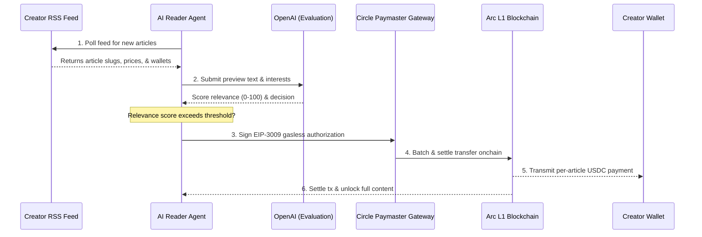
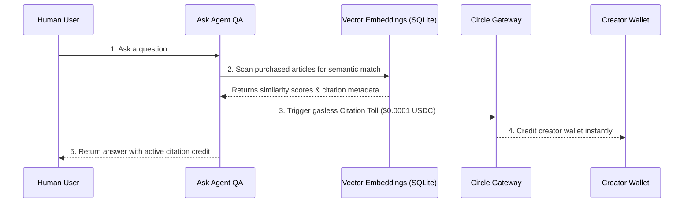

# Inktoll Protocol
> **Gasless Micropayment & Citation Settlement Highway for the Agentic Web3 Knowledge Economy**

Built with **Circle Programmable Wallets**, **Circle Gateway Nanopayments**, and settled on **Arc mainnet** (USDC-native gas chain) for sub-second, frictionless machine-to-human payments.

**Status:** Live on **Arc mainnet** (chainId `5042`) at [inktoll.xyz](https://www.inktoll.xyz). Creator onboarding is open and the mainnet economy is at day zero.


---

## The Vision & Problem
Large Language Models (LLMs) and autonomous AI agents are crawling the web and consuming creators' valuable content for free. In response, publishers are implementing paywalls, putting up aggressive robots.txt blocks, and fracturing the open web. 

**Inktoll solves this crisis by introducing a two-layer machine-to-creator payment protocol:**
*   **Layer 1: Pay-Per-Read:** Autonomous AI agents discover monetize-ready articles via standard RSS feeds, evaluate content relevance using LLMs, and pay creators instantly in USDC for per-article read access.
*   **Layer 2: Citation Tolls:** When agents retrieve knowledge from previously purchased articles to answer human user questions, the protocol detects the semantic citation and routes an automatic **Citation Toll ($0.0001 USDC)** to the creator's wallet.

Inktoll turns content consumption into a functioning Web3 micro-economy where creators get paid directly, agents read legally, and developers operate gaslessly.

---

## Key Innovations (Hackathon Highlights)

### "Proof of Authorship" Verification Badge
To combat plagiarism and ensure secure compensation, Inktoll guarantees 100% of the USDC goes directly to the original creator. Every article in the Reader Feed and Creator Dashboard displays a verified status badge. Unlike competitors that let anyone paste any random URL to hijack revenue, Inktoll relies on secure API handshakes with the creator's platform (such as Ghost) to verify ownership.

### State-of-the-Art Onboarding Tour (Joyride)
To bridge the Web2-to-Web3 divide for creators, the Inktoll Dashboard includes a fully interactive, native **Onboarding Guide** built with React Joyride. The tour highlights and explains complex Web3 elements like the difference between *All-Time Earnings* and *Claimable Balance*, how the *Sync Gateway* operates, and how to withdraw funds on the Arc L1 network, ensuring any traditional blogger feels immediately at home.

### Agent Personas & "Top Spender" Leaderboards
We brought the AI economy to life! Rather than treating AI agents as invisible scripts, Inktoll features a **Top Agent Fans** leaderboard in the Creator Dashboard. Real autonomous reader agents (e.g., `Agent_B2A9`) are ranked dynamically based on how much USDC they have spent unlocking content and citing works. This makes the abstract concept of a "Machine-to-Machine Economy" tangible, social, and extremely engaging.

### Emergent Agentic Swarm Protocol
To max out Agentic Sophistication, our agents don't just execute linear scripts - they exhibit **Decentralized Machine Consensus**. If one agent reads an article and scores it highly (> 85/100 relevance), it autonomously broadcasts a signal to a decentralized Gossip Network. Other listening agents will immediately detect this alpha signal, swarm the target URL, and trigger a cascading spike of gasless USDC payments to the creator without any human intervention.

### Zero-Gas Nanopayments via Circle Gateway
We integrated the **Circle Gateway** to batch gasless off-chain payment authorizations (EIP-3009 / ERC-20 transfers). This achieves sub-cent transactions ($0.001) with **zero gas fees** for the user, net-settling batches efficiently on Arc L1 mainnet.

### State-of-the-Art Glassmorphism UX
The Inktoll Dashboard isn't just functional; it's a visual experience. Built with Next.js and Framer Motion, it features a dark futuristic aesthetic, staggered micro-animations, animated 3D tracking cards, and customized Lucide React icons replacing standard emojis for a premium Web3 infrastructure feel.

---

## Content Platform Integrations

Inktoll fits into a creator's existing workflow by pulling content directly from where they already publish:

*   🟢 **Ghost (LIVE & Fully Integrated)**: Creators can onboard instantly by pasting their blog URL and Content API Key. Inktoll securely syncs and indexes their feed gaslessly.
*   🔵 **X (Twitter) (65% Developed - In Progress)**: A strategic roadmap milestone. Utilizing X OAuth 2.0 and X API v2, creators will be able to stitch together their high-value Twitter threads and monetize social media insights for AI agents.
*   🟢 **Paragraph (LIVE & Fully Integrated)**: Web3-native publishing, home of the former Mirror ecosystem. Creators paste their publication URL — no API key required — and Inktoll verifies authorship cryptographically against the wallet that owns the publication before indexing posts via Paragraph's public content API.
*   🟡 **Substack (Coming Soon)**: Integration with Substack RSS syndication.

---

## Connect Your AI Assistant (MCP)

Inktoll ships a **Model Context Protocol (MCP) server**, so any MCP-capable assistant (Claude, Cursor, and others) can join the machine-to-creator economy directly — browse the catalog, pay writers in USDC via x402, and settle citation tolls — with zero custom integration.

**Endpoint:** `https://agent.inktoll.xyz/mcp?uid=<your-handle>` (streamable HTTP)

```bash
# Claude Code
claude mcp add --transport http inktoll "https://agent.inktoll.xyz/mcp?uid=yourname"
```

**Tools:** `browse_articles` (free catalog), `read_article` (pays the author via x402), `ask_inktoll` (answers that auto-pay citation tolls to cited authors), `wallet_status`, and `claim_faucet` (testnet only).

Your handle keys a personal **Circle developer-controlled wallet** that is auto-provisioned on first use — every assistant gets a wallet.

---

## Counterparty screening (CompliR)

Before USDC moves to an address Inktoll did not create, or arrives from an outside
payer, the address is screened by [CompliR](https://trycomplir.xyz), a
counterparty-risk oracle for USDC on Arc mainnet. A verdict grades the address
`LOW` / `MEDIUM` / `HIGH` with a signed EIP-712 attestation.

**Policy**

| Point | Check |
|---|---|
| Creator withdrawal (`POST /api/creators/withdraw`) | Fresh screen. `HIGH` blocks with HTTP 403; `MEDIUM` is capped at `recommendedLimits.maxPerTxUsdc`. |
| Agent withdrawal (`POST /api/agent/withdraw`) | Same, against the user-supplied recipient. |
| Agent paying an author (`payAndFetchArticle`) | Cached verdict only. Matters because in the MCP flow the payee comes from the server's `payment-recipient` header. |
| Inbound payer (x402 middleware) | Cached verdict only. `HIGH` payers are refused with HTTP 403. |
| Creator onboarding and `POST /api/creators/bind` | Screened once and registered for continuous watching; a `HIGH` tier flags the account without blocking signup. |

**Why only some points pay.** The free lookup returns the whole verdict (tier,
reason codes, recommended limits) and screens an unseen address on demand, so it
is never a cold cache. A paid screen (~0.0081 USDC) adds funder tracing and an
analyst pass; against a 0.02 USDC read earning 0.0002 in protocol fees it is only
worth it on withdrawals and onboarding.

**Outages.** A first sight of an address takes 20-60s server-side, so lookups ask
CompliR to hold the request and it answers `202` with `Retry-After` rather than
hanging. 5xx responses and timeouts get three backoff retries before the fail mode
applies, because a single transient blip must not be mistaken for an outage and
quietly wave a payment through. Outbound payments then fail **closed** regardless
of `COMPLIR_FAIL_MODE`; inbound payer checks honour it, so a reader is not locked
out by an oracle outage.

`decisionId` is stored on the creator record (`risk_tier`, `risk_decision_id`) and
returned in withdrawal responses, so any decision can be replayed at
`https://trycomplir.xyz/log/<decisionId>`.

**Configuration** (see `.env.example`)

```bash
COMPLIR_URL=https://trycomplir.xyz   # empty string disables screening entirely
COMPLIR_FAIL_MODE=open               # "open" allows on outage, "closed" blocks
COMPLIR_CLIENT_ID=inktoll
# COMPLIR_WEBHOOK_URL=https://api.inktoll.xyz   # receives tier.changed events
```

With `COMPLIR_URL` empty, every check returns "allowed" and behaviour is identical
to before the integration.

```bash
cd server && npx tsx src/complir.test.ts   # 12 tests, HTTP mocked
```

---

## Circle Tool Usage & Tech Stack
*   **Circle App Kit & Programmable Wallets**: Frictionless Web2 onboarding for Creators with zero seed-phrases. Creators can log in via **Email OTP (Magic Links)** or **Biometric Passkeys (Smart Accounts)** - making Web3 completely invisible.
*   **Circle Gateway & Unified Balances**: We integrated the Circle Gateway to pool liquidity and hold unified USDC balances. Agents automatically use `depositFor` to deposit base USDC into the Gateway smart contract, enabling instant, cross-chain gasless nanopayments.
*   **Circle Developer-Controlled Wallets**: Secure, programmatic Web3 identity and custodial capabilities for our backend, handling real-time splits on Arc mainnet (routing 99% to creators and a 1% protocol fee to the Inktoll Treasury) upon withdrawal.
*   **Arc L1 Settlement**: Payments settle on **Arc mainnet (chainId 5042)** through Circle's Gateway contract and native USDC, using USDC as the gas token for sub-second finality. Inktoll deploys no custom contracts of its own: the payment logic is an x402 authorization layer over EIP-3009 `TransferWithAuthorization` signatures, settled by Circle Gateway.
*   **x402 Protocol**: We implement HTTP 402 "Payment Required" flows tailored for AI agent execution, creating an autonomous M2M content handshake.
*   **USDC**: The native settlement layer of the protocol, ensuring creators are paid in a universally pegged, stable asset.
*   **AI & Logic Layer**: LangChain and OpenAI `gpt-4o-mini` drive the agent's autonomous relevance scoring and emergent swarm discovery.
*   **Frontend & Database**: Built using Next.js 16, Vanilla CSS, `framer-motion`, and a SQLite ledger.

---

## Protocol Architecture

### 1. Layer 1: Pay-Per-Read Flow


### 2. Layer 2: Citation Tolls Flow


---

## Project Structure
```bash
├── dashboard/      # Next.js web dashboard (Creator Hub, Reader Setup, Leaderboard, Ask Agent)
├── server/         # Node/Express backend SQLite ledger & RSS feed generator
├── agent/          # Autonomous AI Reader Agent runtime & microservices
└── .env            # Shared environment variables
```

---

## Getting Started (Local Setup)

### 1. Prerequisites
Create a `.env` file in the root directory by copying the template:
```bash
# Server Port Configuration
PORT=3001
AGENT_PORT=3002

# API Access
OPENAI_API_KEY=your_openai_api_key
CIRCLE_API_KEY=your_circle_api_key

# Settlement Configuration (Arc Mainnet)
ARC_CHAIN_ID=5042
ARC_BLOCKCHAIN_NAME=ARC
ARC_RPC_URL=https://rpc.mainnet.arc.io
ARC_USDC_ADDRESS=0x3600000000000000000000000000000000000000
ARC_VERIFYING_CONTRACT=0x77777777Dcc4d5A8B6E418Fd04D8997ef11000eE
ARC_EXPLORER_URL=https://explorer.arc.io
CIRCLE_GATEWAY_URL=https://gateway-api.circle.com

# Testnet only: faucet is disabled when ARC_CHAIN_ID is mainnet
FAUCET_PRIVATE_KEY=your_faucet_private_key_with_usdc
```

### 2. Install & Start Server
```bash
# Navigate to backend server
cd server
npm install
npm run build
npm start
```
*   *Server runs at `http://localhost:3001`*

### 3. Install & Start AI Reader Agent
```bash
# Navigate to Agent client
cd ../agent
npm install
npm run build
npm start
```
*   *Agent microservice runs at `http://localhost:3002`*

### 4. Install & Start Web Dashboard
```bash
# Navigate to Dashboard web app
cd ../dashboard
npm install
npm run build
npm start -- -p 3005
```
*   *Dashboard is live at `http://localhost:3005`*

### 5. Production Deployment (VPS)
We include an `ecosystem.config.js` file for seamless production deployments on a VPS.
```bash
npm install -g pm2
pm2 start ecosystem.config.js
```
*This spins up both the Backend Server and Autonomous Agent Loop as robust background daemons keeping them online 24/7.*

---

## License
MIT License. Created by [MrNetwork](https://x.com/encrypt_wizard). Built for the Lepton Agents Hackathon by TheCanteen.
